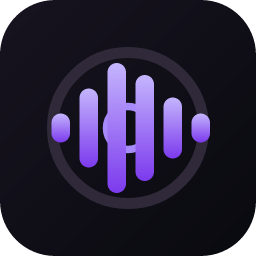

<div align="center">



<h1>djbooth.ai</h1>

<p><strong>Give your agent a DJ booth.</strong></p>

&nbsp;

[![Github Actions][gha-badge]][gha-url] [![Node][node-badge]][node-url] [![Rust][rust-badge]][rust-url]

[gha-badge]: https://img.shields.io/github/actions/workflow/status/gakonst/djbooth/main.yml?branch=main&style=flat-square
[gha-url]: https://github.com/gakonst/djbooth/actions
[node-badge]: https://img.shields.io/badge/Node.js-22%2B-339933?logo=node.js&logoColor=white&style=flat-square
[node-url]: https://nodejs.org/
[rust-badge]: https://img.shields.io/badge/native-Rust-black?logo=rust&style=flat-square
[rust-url]: https://www.rust-lang.org/

**[Install](#installation)**
| [Why djbooth.ai](#why-djboothai)
| [Getting Started](#getting-started)
| [Workbench](#workbench)
| [Architecture](#architecture)
| [Compatibility Journal](packages/rekordbox-ts/PORTING.md)

</div>

---

Agentic, local-first toolkit for taking music from discovery to a prepared DJ set, with 1:1
Rekordbox compatibility at the Pioneer DJ/AlphaTheta hardware boundary.

- **Agent** — Give Codex or Claude a playlist, set URL, or outcome; it finds recordings, reuses what
  you own, analyzes tracks, separates stems, builds playlists, and prepares playback end to end.
- **Workbench** — Browse and manage the same library manually in a local web or native Tauri app,
  with playlists, waveforms, live stems, two decks, EQ, cues, and transition auditioning.

Every layer is also a focused command:

| CLI                         | What it does                                                            |
| --------------------------- | ----------------------------------------------------------------------- |
| `djbooth`                   | Agent Skill, MCP, Code Mode, and umbrella workflow router               |
| `tracks`                    | Resolve sets, acquire recordings, enrich metadata, analyze, and import  |
| `spots`                     | Spotify authentication, catalog lookup, and playlist management         |
| `soundcloud`                | SoundCloud authentication, search, likes, playlists, and exact sources  |
| `slsk`                      | Soulseek search, ranking, and lossless acquisition                       |
| `ytdlp-ts`                  | Inspect, search, and acquire web-hosted audio                            |
| `rekordbox`                 | Read/write compatible databases, ANLZ, settings, XML, analysis, stems   |
| `cdj-usb`                   | Sync playlists, media, analysis, and history to mounted player media    |
| `djlink`                    | Discover players and serve/search/control libraries over Pro DJ Link    |
| `djbooth-rs analyzer`       | Native BPM, key, grid, phrase, and waveform analysis                     |
| `djbooth-rs usb`            | Native USB export runtime                                                |
| `djbooth-rs link`           | Native Pro DJ Link runtime                                               |
| `djbooth-stems-mlx`         | Apple Silicon Mel-Band-RoFormer vocals/drums/bass/other separation       |

```text
"Import this playlist, acquire anything I do not own, analyze it, build a compatible playlist,
and open it so I can audition the transitions."

    prompt → recordings → analysis/stems → library → USB/CDJ
```

## Why djbooth.ai

Rekordbox is the de facto preparation layer for professional DJs because it is tightly integrated
with the Pioneer DJ/AlphaTheta hardware found in booths. [USB Export][rekordbox-professional]
moves prepared tracks and playlists onto standalone players; [PRO DJ LINK][rekordbox-link] loads
the same library and analysis over the network.

[rekordbox-professional]: https://rekordbox.com/en/feature/professional/
[rekordbox-link]: https://rekordbox.com/en/support/link/

A better agent or library manager is not useful if its output stops working when the USB reaches
the booth. djbooth.ai opens and automates the workflow without giving up that interchange contract.

The compatibility target is 1:1 at the boundary the hardware consumes—not a pixel clone of the
Rekordbox UI. djbooth.ai produces compatible database rows, paths, playlists, DAT/EXT/2EX analysis,
waveforms, beat grids, cues, USB layouts, and DJ Link behavior. It emits both legacy Device Library
and newer OneLibrary/Device Library Plus artifacts.

Prepared media works across club-standard CDJs and newer XDJ all-in-one systems, including the
CDJ-2000NXS2, CDJ-3000, XDJ-XZ, and XDJ-AZ. Differential fixtures and physical-player validation
keep compatibility grounded in what the hardware actually reads.

The other half of the thesis is agency. “Find tracks for a late-night warm-up” should create a
playlist you can hear—not stage a literal search for that phrase. The agent can inspect local and
hosted catalogs, acquire missing recordings, parallelize analysis, cache completed work, and carry
the result through to a workbench, USB, or connected player. Every operation remains available to
you directly through the same CLI and UI.

## Installation

The npm release is not public yet. Install from source with Node.js 22:

```sh
gh repo clone gakonst/djbooth ~/github/gakonst/djbooth
cd ~/github/gakonst/djbooth
pnpm install
pnpm build
(cd packages/djbooth && npm link)
djbooth --version
```

Copy [`.env.example`](.env.example) to the ignored root `.env` for provider credentials. Audio,
sessions, cookies, databases, and model caches remain local and outside Git.

## Getting Started

Add djbooth.ai to your agent:

```sh
# Codex
codex plugin marketplace add gakonst/djbooth
codex plugin add djbooth@djbooth-ai

# Claude Code
claude plugin marketplace add gakonst/djbooth
claude plugin install djbooth@djbooth-ai
```

Or install the Skill and MCP command map directly:

```sh
djbooth skills add
djbooth mcp add
```

Then ask for the outcome:

```text
Import this Spotify playlist. Reuse tracks already in my library, acquire the missing recordings,
analyze BPM, key, grids, phrases, and waveforms, then create a Rekordbox-compatible playlist.

Find 20 deep late-night warm-up tracks in my library. Build a rising-energy temporary playlist and
open it so I can audition it.

Sync this playlist fresh to my USB, verify every waveform artifact, and tell me when it is safe to
eject.

Serve my library to the CDJs and cue "Apathy" on player 3 without starting playback.
```

Run the same workflows explicitly:

```sh
# Resolve, acquire, analyze, and import one set.
djbooth tracks import-set "$SET_URL" --manifest "$MANIFEST" --write --format json

# Enrich the complete library idempotently; scope to a playlist folder only when needed.
djbooth tracks enrich --format json
djbooth tracks enrich --folder 'DJ Sets I Like' --dry-run --format json

# Analyze and separate one track.
djbooth rekordbox analyze track ./track.flac --output-directory ./analysis --format json
djbooth rekordbox stems separate ./track.flac ./stems --layout four-stem --format json

# Sync one compatible USB and serve connected players.
djbooth usb sync /Volumes/CDJ --database /path/to/master.db --write --format json
djbooth djlink rekordbox --format json
djbooth djlink rekordbox "Apathy" --player 3 --format json
```

Downloads, provider responses, model weights, analysis, stems, and playlist acquisition are cached.
Warm runs do not redownload or reanalyze unchanged tracks.

## Workbench

Open the local workstation:

```sh
djbooth library serve --open
```

Keep Codex or Claude as the conversation surface and open the UI without its embedded assistant:

```sh
djbooth library serve --open --no-assistant
```

The same workbench ships as the `djbooth.ai` Tauri desktop app. Agent and UI share one local library,
cache, processing queue, and toolchain. Library writes remain explicit; the normal workbench opens
the active database read-only unless write access is requested.

## Architecture

```text
Codex / Claude / Nanocodex                djbooth.ai workbench
              │                                    │
              └────────── Skill · MCP · CLI ───────┘
                                    │
                       TypeScript orchestration
                      ┌─────────────┼──────────────┐
                      │             │              │
             providers/library   djbooth-rs     MLX stems
                      │      analyzer·usb·link     │
                      └─────────────┼──────────────┘
                                    │
                local library · compatible artifacts · CDJs
```

| Path                                          | Responsibility                                      |
| --------------------------------------------- | --------------------------------------------------- |
| [`packages/djbooth/`](packages/djbooth)       | Unified API, CLI, MCP map, and agent Skill          |
| [`apps/djbooth/`](apps/djbooth)               | Browser workstation and Tauri desktop application   |
| [`packages/`](packages)                       | Typed workflow libraries and focused Incur commands |
| [`rust/bin/djbooth-rs/`](rust/bin/djbooth-rs) | Unified native CLI                                  |
| [`rust/crates/`](rust/crates)                 | Reusable analyzer, core, and DJ Link libraries      |
| [`python/stems-mlx/`](python/stems-mlx)       | Standalone uv/MLX stem separator                    |

## Contributing

```sh
pnpm install
pnpm validate
cargo test --manifest-path rust/Cargo.toml --workspace
pnpm test:pack
```

Contributions are welcome. For compatibility work, update the
[porting journal](packages/rekordbox-ts/PORTING.md) with the evidence, fixtures, and hardware scope.

## Support

Having trouble? [Open an issue](https://github.com/gakonst/djbooth/issues/new) with the command,
bounded output, platform, target player, and whether the library path was USB or Pro DJ Link.
